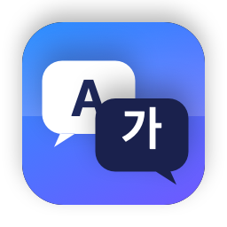

<p align="center"></p>

# QuickTranslate

English · [한국어](README.ko.md)

A tiny macOS menu bar app: press **⌘C twice** and a translation of the selected text pops up next to
your cursor, like the DeepL desktop client. No API keys. It uses the **Claude Code CLI** (your Claude
subscription) or the **Codex CLI** (your ChatGPT subscription) that you already have installed and logged in.

On **Windows and Linux** the same idea is a tray app: select text, press **Ctrl+C twice**. See
[Windows & Linux](#windows--linux).

## Privacy

The app sends the text you translate to the CLI you chose, which sends it to Anthropic (Claude) or
OpenAI (Codex) under your own account. Nothing else leaves your machine: no analytics, no crash
reporting, no API keys. Usage counts against your subscription like any other CLI use.

## Requirements

- macOS 13+, Swift 5.9+ toolchain (Xcode Command Line Tools are enough)
- At least one of these installed and logged in:
  - `claude` — [Claude Code](https://docs.claude.com/en/docs/claude-code) (run `claude` once to log in)
  - `codex` — [Codex CLI](https://github.com/openai/codex) (`codex login`)

## Build & install

```bash
cd macos
./make-cert.sh        # optional, once: self-signed identity so rebuilds keep the Accessibility permission
./build.sh            # builds macos/build/QuickTranslate.app
./build.sh --install  # copies to /Applications and launches it
```

With the default ⌘C ⌘C shortcut **no permission is needed**: the app notices two clipboard changes in quick
succession instead of watching the keyboard. Other shortcuts need the **Accessibility** permission (System
Settings → Privacy & Security → Accessibility); the app asks for it when you pick one, and relaunches itself
once it is granted so macOS starts delivering key events.

> With plain ad-hoc signing every rebuild changes the signature and silently invalidates the permission
> (the switch looks on but nothing works). `./build.sh --install` clears the stale entry so you get asked
> again. Run `./make-cert.sh` once to create a local "QuickTranslate Dev" certificate; `build.sh` then signs
> with it automatically and the permission survives rebuilds. An Apple developer identity also works:
> `CODESIGN_IDENTITY="Apple Development: ..." ./build.sh`.

## Usage

| Action | How |
|---|---|
| Open the translation popup | Select text, press **⌘C ⌘C** (twice within 0.4s, or hold ⌘ and tap C twice). Configurable, see Settings |
| Change target language | Picker at the top of the popup (retranslates immediately) |
| Edit the source and retranslate | Edit the text at the top, then **⌘⏎** |
| Copy the translation | **⇧⌘C** or the Copy button |
| Close | **Esc**, ⌘W, the window's close button, or click outside (not while a translation is still running) |
| Minimize / zoom | ⌘M or the window buttons; the next shortcut press brings it back |
| Cancel a running translation | **⌘.** or the Cancel button (partial text stays) |
| Keep it open | 📌 pin button |

By default it translates into your system language, and if the text is already in that language it
translates into your next preferred language (or English). Change this in Settings.

## Settings

Menu bar icon → **Settings…**

- **Engine**: Claude (Claude Code CLI) or ChatGPT (Codex CLI)
- **Model**: for Claude `haiku` (default, fastest) / `sonnet` / `opus`; for Codex leave blank for the default
- **Keep Claude running in the background**: on by default. A resident `claude` process (~240 MB RSS,
  ~110 MB memory footprint) skips the CLI start-up (~0.5 s) on every translation. Turn it off to spawn a fresh
  process per translation.
- **CLI path**: set manually if auto-detection fails (e.g. `~/.local/bin/claude`)
- **Languages**: default target language and the fallback used when the text is already in it
- **Interface language**: follow the system, or force English / 한국어 / 日本語 (the app restarts to apply)
- **Shortcut**: click "Change…" and press any combination (needs ⌘, ⌥ or ⌃, or a function key). Two trigger
  modes: **Press twice** (the default ⌘C ⌘C style, where the shortcut is also the app's copy command) or
  **Press once** (a dedicated shortcut such as ⌃⌥T; the app sends ⌘C for you to copy the selection, and the
  keystroke is not passed on to the app underneath). How each is detected: ⌘C ⌘C from clipboard changes
  (no permission, immune to Secure Keyboard Entry), other press-twice shortcuts via a CGEvent tap
  (Accessibility), press-once shortcuts via the system hot key API
- **Double-press interval**, **Close when clicking outside**

## When the hotkey does not fire

- **Secure Keyboard Entry**: terminals (iTerm2, Ghostty, cmux, …), password fields and some Electron apps turn
  this on, and macOS then blocks global key monitoring for every app, sometimes even while that app is in the
  background. The default ⌘C ⌘C shortcut is immune because it is detected from the clipboard, and single-press
  shortcuts use the system hot key API. Only "press twice" shortcuts other than ⌘C depend on key events; for
  those the menu bar menu and Settings show which app has Secure Keyboard Entry enabled.
- **Permission granted after launch**: macOS decides at launch whether a process receives key events, so the
  app relaunches itself automatically once the permission appears.

## Triggering from other tools

Raycast, Hammerspoon or any script can open the popup for the current clipboard:

```bash
osascript -l JavaScript -e 'ObjC.import("Foundation"); $.NSDistributedNotificationCenter.defaultCenter.postNotificationNameObject("dev.swen.QuickTranslate.translate", $())'
```

Logs go to `~/Library/Logs/QuickTranslate.log`.

## Windows & Linux

A separate Tauri app in [`desktop/`](desktop) with the same panel, engines, languages and settings
as the macOS app. It lives in the system tray (notification area) and has no window until you
use it. Downloads are on the [releases page](https://github.com/longfin/quick-translate/releases)
(tags `desktop-v*`).

### Requirements

- **Windows** 10 (1803 or later) or 11, x64 or ARM64. The app draws its UI with the Microsoft
  Edge **WebView2** runtime: preinstalled on Windows 11 and on up-to-date Windows 10; the installer
  downloads it if it is missing (the portable zip doesn't, get it from
  [Microsoft](https://developer.microsoft.com/microsoft-edge/webview2/)).
- **Linux** x86_64 or aarch64 with glibc 2.35 or newer (Ubuntu 22.04, Debian 12, Fedora 36 and
  later), on X11 or Wayland. The tray icon needs `libayatana-appindicator3-1` (the `.deb` pulls it
  in). **GNOME** has no tray of its own: it needs the AppIndicator extension, which Ubuntu ships
  enabled; elsewhere install `gnome-shell-extension-appindicator` and turn it on in Extensions.
  KDE Plasma, Xfce, Cinnamon and MATE work as they are.
- The `claude` or `codex` CLI, installed and logged in, as on macOS. Installed through npm they
  also need **Node.js** (18 or later), found next to the CLI or on the `PATH`.

### Install

**Windows**

- **Installer** (`QuickTranslate-<version>-windows-x64-setup.exe`, or `-arm64-` for ARM PCs):
  installs for the current user, no administrator rights, and adds a Start menu entry.
- **Portable** (`…-windows-x64-portable.zip` / `-arm64-`): unzip anywhere and run
  `quicktranslate.exe`. Settings and the log still go to your user profile.

The builds are not code-signed, so SmartScreen says "Windows protected your PC" the first time:
click **More info → Run anyway**.

**Linux**

- **AppImage** (`QuickTranslate-<version>-linux-x86_64.AppImage` or `-aarch64`), any distro:
  ```bash
  chmod +x QuickTranslate-*.AppImage
  ./QuickTranslate-*.AppImage
  ```
  AppImages need FUSE 2 (`sudo apt install libfuse2`, `libfuse2t64` on Ubuntu 24.04). Without it,
  run it with `--appimage-extract-and-run`.
- **Debian / Ubuntu** (`QuickTranslate_<version>_amd64.deb` or `_arm64.deb`):
  ```bash
  sudo apt install ./QuickTranslate_*_amd64.deb   # then start "QuickTranslate" from the app menu
  ```

`SHA256SUMS` next to the downloads lists the checksums. To start it with your session, tick
**Run at startup** in Settings.

### Usage

Select text and press **Ctrl+C Ctrl+C** (twice within 0.4 s): the translation panel opens next to
the cursor. The tray icon's menu has **Translate clipboard**, **Settings…** and **Quit**. In the
panel, **Esc** or **Ctrl+W** closes it (so does clicking outside, unless a translation is still
running), **Ctrl+Enter** retranslates the edited source, and the pin keeps it open and on top.
Settings are the macOS app's, plus **Run at startup**.

**How the trigger works.** Like ⌘C ⌘C on the Mac, Ctrl+C Ctrl+C is detected from the clipboard,
not the keyboard: two copies within the interval mean "translate". No keyboard hook and no
permissions. The app is notified of clipboard changes by Windows' clipboard listener, by XFixes on
X11, and by the data-control protocol on Wayland compositors that have it (KDE Plasma, Sway,
Hyprland and other wlroots ones).

**Hotkey instead.** In Settings → Trigger, **Press once** uses a global shortcut
(`Ctrl+Shift+T` by default). It translates what is already on the clipboard, so copy first.

**Wayland on GNOME.** GNOME has neither data-control nor (for apps like this one) global shortcuts.
When XWayland is running, the app watches its clipboard instead, which follows copies from
Wayland apps too. Without XWayland, use the tray's **Translate clipboard**, or bind a GNOME
keyboard shortcut (Settings → Keyboard → Custom Shortcuts) to `quicktranslate --translate`. The
log says which watcher is in use (`trigger: clipboard watcher = …`).

**From scripts.** With the app running, `quicktranslate --translate` opens the panel for the
clipboard and `quicktranslate --settings` opens Settings (the second launch passes the request on
and exits). The command is `quicktranslate` (`/usr/bin/quicktranslate` from the `.deb`), the
AppImage itself, or `quicktranslate.exe` on Windows (`%LOCALAPPDATA%\QuickTranslate\` for the
installer).

### Troubleshooting

- **"`claude` CLI not found"**: the app looks on the `PATH` and in the usual install places (npm's
  global folder, Volta, fnm, nvm, bun, scoop, `~/.local/bin`, …), then asks a login shell
  (`where.exe` on Windows). If yours is elsewhere, set **CLI path** in Settings and press **Test**
  (`where claude` in a terminal on Windows, `command -v claude` on Linux, shows the path). On Windows
  npm installs a `claude.cmd` shim; point the setting at it or at `claude.exe`.
- **Works in a terminal, not from the app menu**: launchers don't read `.bashrc`, so a `PATH` set
  there is missing. The app adds the CLI's own folder to the `PATH` it passes on, so an npm shim
  finds the `node` next to it (nvm, fnm). If `node` lives somewhere else, set the CLI path to a
  wrapper script or install Node system-wide.
- **No tray icon on GNOME**: enable the AppIndicator extension (see Requirements) and log out and
  in. The icon is a white glyph made for dark panels; on a light panel it is hard to see.
- **Ctrl+C Ctrl+C does nothing**: check the log for the watcher (see Wayland above), or switch to
  the hotkey.
- **Logs**: `%LOCALAPPDATA%\QuickTranslate\QuickTranslate.log` on Windows,
  `~/.local/state/QuickTranslate/QuickTranslate.log` on Linux (`$XDG_STATE_HOME` if set).
  Settings are in `%APPDATA%\dev.longfin.quicktranslate\settings.json` and
  `~/.config/dev.longfin.quicktranslate/settings.json`.

## Localization

The UI is English by default and switches to Korean or Japanese automatically based on the system
language. On first launch the default translation languages follow the system language too. To add a
language, create `macos/Resources/<lang>.lproj/Localizable.strings` (keys are the English strings).

## How it works

- ⌘C ⌘C is detected by polling `NSPasteboard.changeCount` every 60 ms: every copy bumps it, so two bumps
  within the interval mean a double copy. Other shortcuts use a CGEvent tap (press twice) or
  `RegisterEventHotKey` (press once). The result is shown in a non-activating floating `NSPanel` near the
  mouse that never steals focus from the app you are in.
- Claude: runs `claude -p --output-format stream-json --include-partial-messages --tools "" --strict-mcp-config --setting-sources ""`
  and streams tokens into the panel. The flags skip your user settings, hooks and MCP servers so it starts fast
  and sends only a few hundred input tokens. Extended thinking is disabled (`MAX_THINKING_TOKENS=0`).
- With "Keep Claude running" on, a single `claude -p --input-format stream-json` process stays alive. Each
  translation is one user message; after the result the app sends `/clear`, which the CLI handles locally, so
  every translation starts from a fresh context while the process, connection and prompt cache stay warm.
  Cancelling or changing the model restarts the process.
- Codex: runs `codex exec -s read-only -o <file>` and reads the final message (no streaming).

## Project layout

`macos/` is the macOS app. `desktop/` is the Tauri app for Windows and Linux; its layout is in
[`desktop/README.md`](desktop/README.md).

```
macos/Sources/QuickTranslate/
  main.swift                 entry point (menu bar only, no Dock icon)
  AppDelegate.swift          status item menu, permission flow, clipboard trigger, auto-relaunch
  Hotkey.swift               shortcut model, key labels, synthetic ⌘C
  PasteboardWatcher.swift    ⌘C ⌘C detection from clipboard changes
  HotkeyMonitor.swift        press-twice detection for other shortcuts (CGEvent tap)
  CarbonHotkey.swift         press-once shortcuts (RegisterEventHotKey)
  SecureInput.swift          Secure Keyboard Entry detection
  TranslationPanel.swift     floating panel (placement, outside-click close, Esc)
  TranslationView.swift      panel UI (SwiftUI)
  TranslationViewModel.swift translation state / streaming
  TranslationEngine.swift    claude / codex invocation and output parsing
  ClaudeWorker.swift         resident claude process (stream-json in/out, /clear between turns)
  ProcessJob.swift           child process runner with line-streamed stdout
  CLILocator.swift           finds the CLI binaries (Finder-launched apps have a minimal PATH)
  Settings.swift             UserDefaults-backed settings
  SettingsView.swift         settings window
  L10n.swift                 localization helper
macos/Resources/
  Info.plist, AppIcon.icns, MenuBarIcon{,@2x}.png, en/ko/ja.lproj/Localizable.strings
  Icon/generate.swift        draws the icons; regenerate with ./build-icons.sh
```

## Contributing

See [CONTRIBUTING.md](CONTRIBUTING.md).

## License

[MIT](LICENSE)
